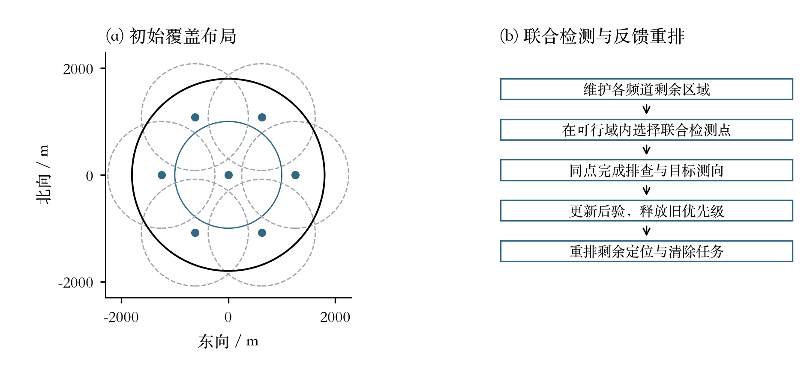
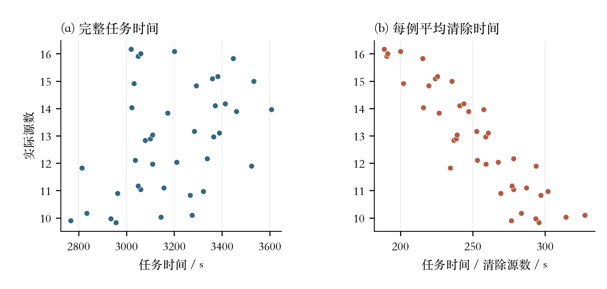
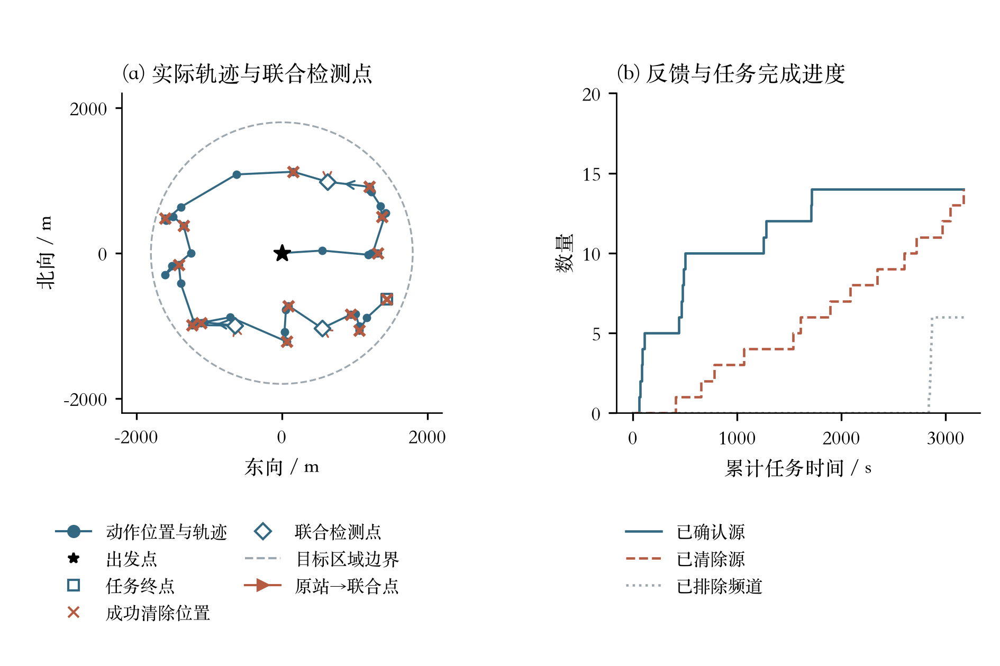
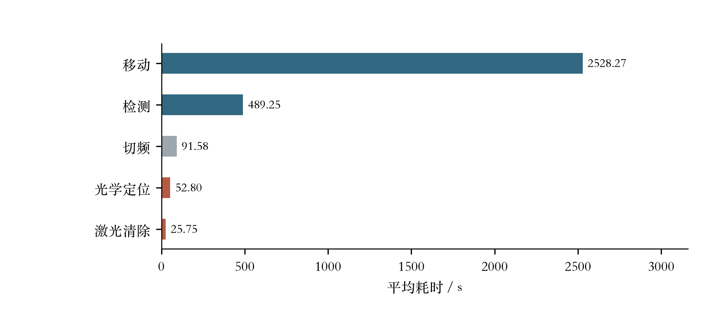

# 问题3：具有无遗漏证书的联合搜索、定位与清除策略

**解析补充已完成：** 已核对期望边长上下界、有限路线筛选、压缩误差界和独立整程对照。排序改进版收益不稳定，因此本正文的冻结主策略保持不变。局部几何模型的误差保证不等于整程全局最优保证。

采用**保守区域排查、单源后验定位、联合检测点和反馈后任务重排**相结合的策略。排查保证未知源不会被遗漏，后验用于缩短定位清除时间，联合检测点使定位与排查共享行程；取得新反馈后重新安排清除顺序。

主实现固定为 `q3_joint_replan.JointReplanPolicy`，整程评价指纹为 `883f1a9955c8b242`。本地21组独立配对环境中，清除273/273个源，平均总耗时3171.57秒，比同批固定骨架插入策略减少3.93%。本次新增14组聚集、边缘压力环境，182/182个源全部清除。

**交付边界：** 策略、算法、无遗漏依据、本地实验和HTTP入口已整理完成。尚未进行官方模拟器演练和三次正式测试，文末正式表格保留待测状态，本地结果不冒充正式成绩。

## 1. 目标与计时模型

目标域为 $A=B(O,1800)$，源数 $N\in\{10,\ldots,16\}$ 未知，每个源占不同频道，频道共20个。本问全部为全向源，接收半径固定但未知，位于1000—1500米；距离不超过5米时给出近距离提示，其余可接收位置给出带误差示向度。光学定位清除只在目标距离不超过20米时成功。

设总行程为 $L$，检测次数为 $M$，检测切频次数为 $S$，光学清除尝试次数为 $A_c$，成功清除数为 $K$，则

$$\boxed{T=L/5+5M+S+3A_c+2K.}\tag{1}$$

全部清除时，若失败清除次数为 $F$，等价地有 $T=L/5+5M+S+3F+5N$。清除指令不改变接收频道。任务完成后可在当前位置退出，不要求返回原点。

优化目标是在取得完整清除证书的前提下缩短预计总时间；不宣称已取得连续空间全局最优。

## 2. 后验状态：概率用于优化，几何用于保证

每个频道维护未知是否存在、已发现待清除、已清除、已证明不存在四种状态，同时保存全部反馈、位置可行区域和概率分布，以及固定接收半径的条件分布。已清除源仍计入已确认的原始源数。

题设未给出完整概率分布。期望计算和本地均匀实验采用：$N$在10—16间等概率；给定 $N$ 后占用频道子集等概率；位置按圆域面积均匀；固定接收半径均匀取1000—1500米；新位置误差均匀取 $[-1^\circ,1^\circ]$。这些是建模假设，不是题设保证。概率影响效率，不能代替连续区域证书。

### 2.1 单源后验

设方向观测集合为 $D$，无信号观测集合为 $M_0$。给定源位置 $g$，同一个固定接收半径的历史可行区间为

$$L(g)=\max\{1000,\max_{j\in D}\|g-p_j\|\},\quad
U(g)=\min\{1500,\min_{j\in M_0}\|g-p_j\|\}.$$

读数 $\alpha_j$ 保留两位小数。若真实方位为 $\phi_j(g)$，周期角差为 $e_j=\alpha_j-\phi_j(g)$，角度单位为度，则

$$h_j(g)=|[-1,1]\cap[e_j-0.005,e_j+0.005]|/2.$$

积分掉固定接收半径，位置后验为

$$\boxed{f(g\mid H,E=1)\propto f_0(g)K_H(g)
\frac{[U(g)-L(g)]_+}{500}\prod_{j\in D}h_j(g).}\tag{2}$$

$K_H$ 包含目标域、方向反馈距离大于5米、近距离反馈距离不超过5米及清除成败的20米距离约束。位置给定后，半径在非空 $[L(g),U(g)]$ 上条件均匀。不能每次重抽与历史无关的半径；同频道同位置误差固定，重复读数不增加独立证据。

### 2.2 多频道存在性

设 $E_c$ 表示频道 $c$ 是否原本有源，$z_{c0},z_{c1}$ 为不存在、存在条件下的历史证据，则

$$P(E\mid H)\propto
\frac{\mathbf1_{10\le\sum_cE_c\le16}}{7\binom{20}{\sum_cE_c}}
\prod_{c=1}^{20}z_{c0}^{1-E_c}z_{c1}^{E_c}.\tag{3}$$

实现用多项式系数计算数量及频道边缘后验。频道信号互不影响，不意味着存在状态在源数约束下相互独立。

## 3. 排查责任与无遗漏覆盖

“至少绕一圈”不是严格路线定理。实际要求是取得未知频道的排除证书，路线可以开放，站点可以随任务变化。

实际 $N\le15$ 时，若某空频道仍有未被有效排除的位置，则可在那里加入一个半径1000米的新源，仍符合数量限制并与已知反馈相容，故不能凭小概率停止。若已确认16个原始源，则可用数量上界排除其他频道。

### 3.1 初始可行布局

原点扫描后，采用六个半径1250米、方位间隔60°的外围站作为初始覆盖布局。原点与这六站的1000米接收圆覆盖目标域。原点是本策略的选择，不是任何策略的几何必需点。

完整原点20频道扫描费用119秒；若根据已确认16源提前解决其他频道，则批次可提前结束。此后只扫描仍未知的频道，优先当前频道以减少切换。

实现把目标域保守外包为25米方格。站点 $q$ 对中心为 $x$ 的方格，只有满足

$$\boxed{\|\,|x-q|+(12.5,12.5)\,\|\le999.9}\tag{4}$$

才记为整格覆盖，而非只检查格子中心。999.9米留有执行余量。

### 3.2 每个未知频道单独记录剩余区域

无信号只为该频道删去本次有保证接收的整格。设 $W_c$ 为频道 $c$ 的未排除方格，未来站点集合为 $Q$，保持

$$\boxed{\bigcup_{c\text{ 未知}}W_c\subseteq\bigcup_{q\in Q}\operatorname{Cover}(q).}\tag{5}$$

站点只有在本批未知频道扫描完成后才解除任务。正信号把频道变为已知源，新增定位清除任务，不再要求对该频道证明不存在。

## 4. 联合检测点与反馈后重排

用已知源后验均值生成开放任务路线，按最小新增距离把源任务插入覆盖站序列。均值只作排序代理，不作为真实坐标或保证清除依据。

当前两个首任务若恰为“一站一源”，尝试共享检测位置。原站为 $b$，其他未来站无法承担的剩余方格为 $F_b$，替代位置的可行域为

$$\boxed{\mathcal Q_b=\bigcap_{x\in\operatorname{Corners}(F_b)}B(x,999.9).}\tag{6}$$

候选来自原站、后验均值、局部定位建议和横向偏移；沿原站到候选目标的线段求最远可行点，并重新核对式(5)。主算法只替换当前相邻站源组合，不同时全局优化所有站和所有源。

用48个共同后验情景，保持同一情景内固定接收半径，比较原安排与联合安排的移动、操作、清除和出口成本。预计配对节省为 $\bar\Delta$ 时，采用

$$\bar\Delta-2s_\Delta/\sqrt{48}>10\text{ 秒}$$

作为接受阈值。这是经验筛选，不是多候选选择后的全局95%置信保证。

联合点完成未知频道扫描，再在同一点测一个已知源。**取得全部新反馈后，释放原清除优先级与旧出口，重新安排剩余任务。** 原目标仍保留为待清除，不能因释放优先级而丢失。这样使信息采集位置与反馈后的清除顺序分开。

<!-- paper-figure:question3/图1_覆盖与反馈机制 -->


**图1 覆盖与反馈机制。** 左图为正文指定的原点加六个外围站的初始覆盖布局，外围站半径1250 m、间隔60°，接收圆半径1000 m。右图表示联合检测与反馈重排的逻辑；本图是算法机制示意，不是实际行进轨迹，也不主张必须绕一圈。
<!-- /paper-figure -->

## 5. 单源定位、清除与有限后备

对选定源依次处理：

1. 收到过近距离反馈：到该位置直接清除。
2. 当前点或后验均值的19.999米圆能覆盖整个保守可行区域：执行保证清除。
3. 否则比较直接尝试清除与新测向点。第二问解析近似提供部分候选，最终按二维后验情景及包含实际出口的续策评估。
4. 每源首次发现后最多追加5次测向，并限制自由清除尝试；仍未成功时，使用28米有限后备清除网格的方格中心执行后备清除。25米方格仅用于未知频道排查与七站覆盖证书。

28米有限后备清除网格的半边长为14米，格中心到整格任意点至多 $14\sqrt2\approx19.799$ 米，小于20米清除半径，故20米清除圆覆盖整格。清除失败即可排除该整格，剩余格数严格减少；成功则跳过该源剩余尝试。

保证清除检查整个可行区域，不将“交会区域直径不超过40米”直接当作20米圆可覆盖的充分条件。概率计算异常时转入几何后备，零粒子质量不作为无源证书。

## 6. 完整流程与终止依据

```text
初始化原点、接收频道1、20频道状态和历史
在原点扫描未知频道，更新全部已接受的反馈
建立外围六站和整格覆盖不变量
循环：
    若每个频道已清除或有不存在证书：退出
    若联合检测批次尚未结束：继续执行
        批次和已知源测向完成后，更新反馈并释放旧清除优先级
    否则若正在完成一个源：执行有次数限制的定位/清除续策
    否则：
        将已知源插入剩余覆盖站的开放路线
        为首个相邻站源组合寻找有证书的联合点
        预计节省通过阈值则合并，否则执行原路线首任务
    每次只发送一个动作，accepted=true后才更新状态
```

正确性依赖四个不变量：真实源位置保留在保守几何集合内；未来站覆盖所有未知频道剩余区域；不存在证书来自连续排除或已确认16源；结束时已确认源全部收到清除成功，其余频道全部取得不存在证书。

扫描任务有限，额外测向有上限，失败后备使格数减少，构成理想合法执行下的有限完成机制。这不等于已证明任意允许环境均能在20分钟现实时间或100小时虚拟上限内完成；时间限制内的表现仍需实验检验，目前无最坏运行时间保证。

## 7. 整程实验结果

### 7.1 独立配对实验

按源数10—16各3例，共21例；三种策略共享隐藏环境与固定位置误差。规划器种子固定9101，环境种子、真实源数、真实位置及半径不进入策略，只用于离线反馈与核验。

| 策略 | 全部完成 | 清除源/总源 | 平均总时间/秒 | 每例每源时间的平均/秒 |
| --- | --- | --- | ---: | ---: |
| 固定骨架插入 | 21/21 | 273/273 | 3301.46 | 258.89 |
| 联合点，提前固定清除目标 | 21/21 | 273/273 | 3315.58 | 259.76 |
| **联合点，反馈后重排（定稿）** | **21/21** | **273/273** | **3171.57** | **248.78** |

相对固定骨架，平均节省129.89秒，即3.93%；20/21例更快，按源数分层的配对95%区间[91.44,168.34]秒。相对锁定目标的联合点，平均节省144.01秒，即4.34%。每层仅3例，未作多重比较校正，结论限于本地生成模型。

每次测试应分别计算 $r_j=K_j/N_j$、$a_j=T_j/K_j$。表中248.78秒是 $\frac1{21}\sum_j a_j$；全部时间除以全部清除数则为243.97秒，两种权重不能混用。

定稿策略的平均耗时分解：

| 项目 | 秒 |
| --- | ---: |
| 移动 | 2515.62 |
| 检测 | 486.67 |
| 检测切频 | 90.86 |
| 光学定位（含失败尝试） | 52.43 |
| 激光清除 | 26.00 |
| 合计 | 3171.57 |

### 7.2 定稿版本新增压力测试

聚集、边缘布局各按源数10—16取一例。聚集点在 $(1050,650)$ 附近生成，边缘点在半径1650—1800米之间生成，均偏离规划器的面积均匀先验。

| 本地压力环境 | 完成 | 清除源/总源 | 平均总时间/秒 | 每例每源时间的平均/秒 |
| --- | --- | --- | ---: | ---: |
| 聚集布局 | 7/7 | 91/91 | 2550.48 | 203.24 |
| 边缘布局 | 7/7 | 91/91 | 3365.73 | 263.77 |

它们没有同批其他策略对照，不能推出相同提速比例。定稿版共35个本地环境、455个源全部清除。加上两种对照，77份整程日志、8866个动作、539份不存在证书通过回放、计时与几何复核。30项已有策略/几何测试和7项新增协议测试通过；协议整程测试使用内存模拟服务，未进入官方测试。

### 7.3 新增40次本地运行

新增批次 `batch-20260913-183116-6270521a` 的40个均匀场景使用联合重排策略，版本哈希 `ede0b2c65ab649f3`，与本文件夹当前代码一致。40/40次全部完成，共清除515/515个源；平均任务时间3187.65秒，中位数3164.49秒，标准差206.67秒。每例平均清除时间T/K的算术平均为252.47秒；全部时间除以全部清除数为247.58秒，两者采用不同权重。

日志包含4618个动作，接受联合检测点135次、候选评估345次。本轮绘图核对了版本、动作数、累计移动距离、计时分量与末次反馈时间；完成证书状态来自原日志，本轮未重新运行连续几何证书审计。该批仅含一种策略，用于补充绝对性能与执行过程，不能替代7.1节的独立配对比较，也不是官方模拟器成绩。

配套记录见[新增40次运行结果表](../论文图表/question3/表1_新增四十次运行.md)。


<!-- paper-figure:question3/图2_四十次运行结果 -->


**图2 四十次运行结果。** 新增40次本地均匀场景运行，版本ede0b2c65ab649f3。每点为一次运行，同源数内纵向错开。40/40次全部完成，共清除515/515个源。平均任务时间3187.65 s，中位数3164.49 s；每例T/K的算术平均为252.47 s，全部时间除以全部清除数为247.58 s。该批仅包含联合重排策略，不能独立计算相对其他策略的提速。
<!-- /paper-figure -->

<!-- paper-figure:question3/图3_实际轨迹与反馈 -->


**图3 实际轨迹与反馈。** 按任务时间距样本中位数最近的规则选择种子1200018，若并列取时间较短者，非择优展示。该例任务时间3172.30 s，清除14/14个源。左图蓝色圆点为动作执行位置、蓝线为行进轨迹（蓝色箭头表示行进方向），并非源的位置；砖红叉为成功清除位置，空心菱形为接受的联合检测点，砖红箭头从原站指向联合点；星号为出发点，空心方形为终点。右图按逐动作反馈画阶梯曲线，已排除频道数与已清除源数含义不同。
<!-- /paper-figure -->

<!-- paper-figure:question3/图4_平均耗时分解 -->


**图4 平均耗时分解。** 新增40次运行的平均任务耗时分解。光学定位时间包含失败尝试，激光清除仅按成功清除计时；五项未舍入均值之和等于3187.65 s。墙钟计算时间不属于题目任务时间，未混入本图。
<!-- /paper-figure -->

## 8. 新理论在定稿中的位置

不把局部节省或纯几何改善叠加到3171.57秒上。

| 内容 | 定稿状态 |
| --- | --- |
| 固定半径后验、整格覆盖、有限清除后备 | 主算法已使用 |
| 一站一源联合检测、反馈后重排 | 主算法已使用，有独立整程对照 |
| 第二问解析候选 | 提供部分局部选点，最终有二维情景评估 |
| 信息价值、测量延后、两阶段反馈 | 理论改进，未替换主控制器 |
| 多站凸优化、自由角度和非对称覆盖 | 几何研究，不作为定稿整程成绩 |

理想价值是当前费用加反馈后重选续策的预计完成成本。主实现仍为有限候选、48情景与贪心插入近似，不是完整多源动态规划。

## 9. 运行入口及正式测试待填表

`q3_simulator_client.py`按附件协议接入 `/enter`、`/measure`、`/clear`、`/exit`。只提交声明字段，转换 `measure_result`、`svd_deg`、`clear_result`，串行发送请求。传输不确定时复用相同请求体与ID；明确拒绝不更新策略，也不以拒绝响应中的0覆盖有效虚拟时间。真实时限使用 `/enter`返回的实际剩余时间。只有取得完成证书才正常 `/exit`。

客户端导入或不带 `--run`执行时不会连接。运行方法保存在代码目录README中。本次只完成模拟协议测试，尚未验证官方服务器实际连接。

按题面表1保留正式结果：

| 测试案例编码 | 清除干扰源个数 | 平均定位清除时间 | 程序运行时间 |
| --- | --- | --- | --- |
| 待正式测试1生成 | 待测 | 待测 | 待测 |
| 待正式测试2生成 | 待测 | 待测 | 待测 |
| 待正式测试3生成 | 待测 | 待测 | 待测 |

案例编码和正式程序运行时间取模拟器显示值，每源时间按该次有效虚拟总时间除以清除数。正式接口不返回源总数；演练结束后另用界面显示的总数计算清除比例。

尚需官方演练、三次正式测试，并从模拟器导出三份加密日志、保留原文件名。本地JSONL及实验日志不能替代它们。按当前授权，这些官方操作未执行。

## 10. 可复核文件

- [主策略](代码/q3_joint_replan.py)、[HTTP入口](代码/q3_simulator_client.py)、[本地40次入口](代码/run_q3_simulator_40.py)。

规则依据为[题面及附录](../B题%202/B题/B题.pdf)、[使用说明](../B题%202/B题/附件/附件1.docx)、[通信协议](../B题%202/B题/附件/附件2.docx)。本次核对了表1与协议字段，未修改题目及附件。

