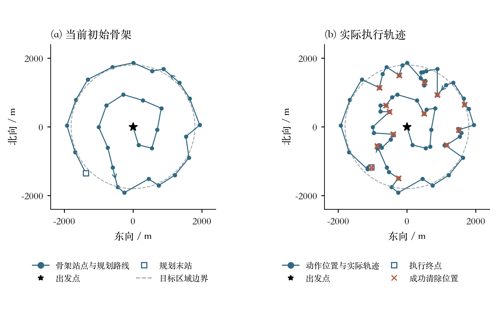
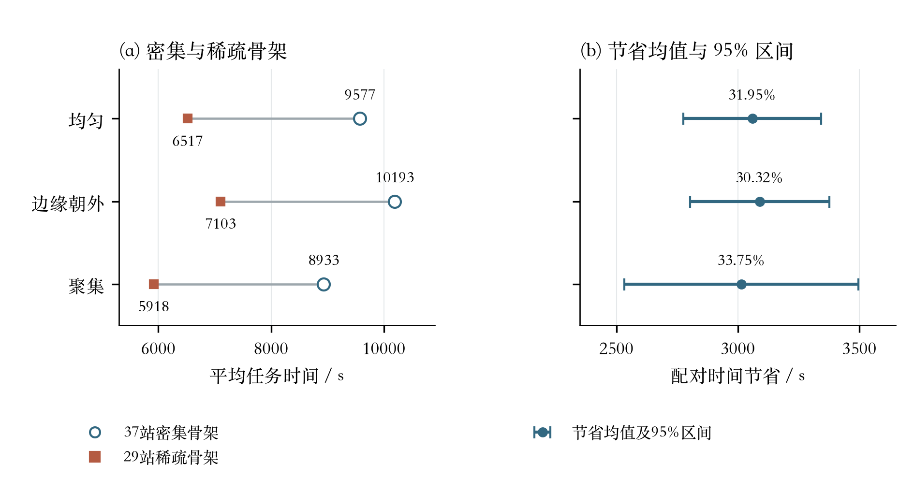
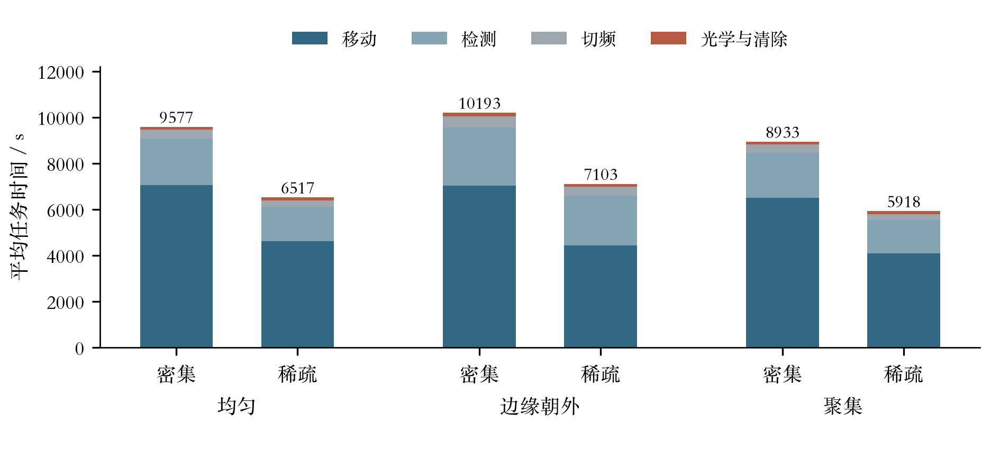
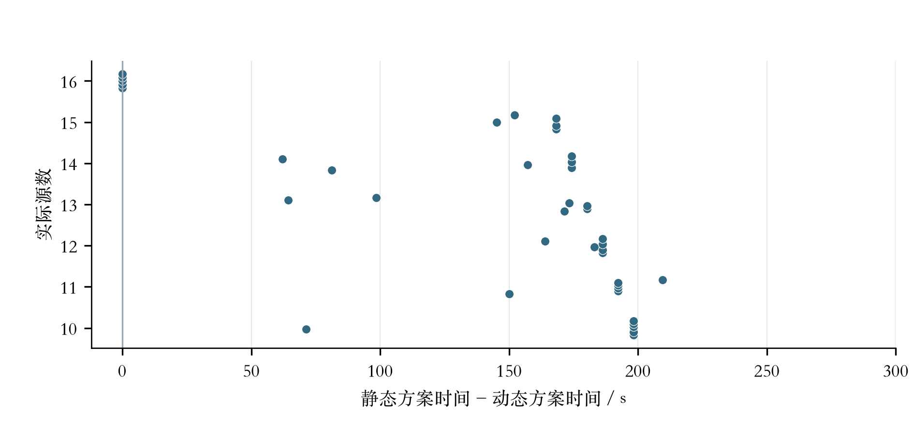

# 第四问：混合源搜索、定位与清除

本文件同时说明论文正式主方案与补充优化实验。论文正式主方案为 V5 / sparse / 29站稀疏骨架；动态提前停止方案对应 `代码/动态骨架_v1/q4_dynamic_policy.py`，仅作为补充优化实验。算法在29个后续站加原点的稀疏骨架上组织排查，用连续方向覆盖证书保证无遗漏，用有界事件触发的两步场景树处理定位受阻状态；每次反馈更新后再用后验概率判断能否提前收工。全部结果来自本地规则模拟，未连接官方模拟器。

## 0. 当前版本与主要结果

| 项目 | 结果 |
| --- | --- |
| 补充动态策略 | `动态骨架_v1/q4_dynamic_policy.Policy()`：25米清除方格、一步前瞻为主、定位受阻时每源至多一次两步场景树，并在反馈更新后按1%后验概率提前停止 |
| 排查骨架 | 29个后续站加原点，开放路线17505.97米，25米整格连续方向证书 |
| 三类场景配对 | 相对37站密集骨架节省约30.3%—33.7%，42/42局更快，546/546个源清除，证书审计通过 |
| 新旧算法配对 | 相对29站静态骨架旧算法，40局平均虚拟时间由6328.33秒降至6183.91秒（省144.42秒，2.28%），35/40局更短、5局相同，40/40局清除全部实际源，CPU时间持平 |

三类场景的骨架对照原始记录见[结果汇总](表格/问题四结果汇总.json)，本次算法更新的同种子40局配对报告见[对比报告](数据/对比40次/20260913-145508-pair40/对比报告.md)，改动细节见[更新说明](更新说明.md)。

## 1. 状态、观测与成本

每个频道至多一个源。隐藏状态为

$$z_c=(E_c,g_c,R_c,\tau_c,\theta_c),\quad
g_c\in A=B(O,1800),\ R_c\in[1000,1500].$$

$E_c$ 表示是否原本存在，$\tau_c\in\{\mathrm O,\mathrm D\}$ 表示全向或定向；$\theta_c$ 是定向源固定不变的发射方向。总数在10—16之间。源被清除后，原始存在状态仍计入数量约束。不同源各占一个频道，信号不互相干扰，但存在状态受总数限制，并非无条件独立。

令 $u(\theta)=(\cos\theta,\sin\theta)$，机器狗位于 $p$。接收条件为

$$\boxed{\chi(p;z)=\mathbf1_{\|p-g\|\le R}
\left[\mathbf1_{\tau=\mathrm O}+\mathbf1_{\tau=\mathrm D}\mathbf1_{u(\theta)\cdot(p-g)\ge0}\right].}\tag{1}$$

这里是**源指向机器狗**的向量 $p-g$；示向度则是机器狗指向源的 $g-p$，两者相差180°。定向源的有效角度为180°，两侧边界包含在内。不是测向机需要额外选择一个扫描方向。

- $\chi=0$：无信号。
- $\chi=1$ 且距离不超过5米：近距离反馈，无示向度。
- $\chi=1$ 且距离大于5米：示向度，误差在±1°内，保留两位小数。同频道同一位置误差固定。
- 清除成功当且仅当距离不超过20米，**不受发射方向限制**。清除指令不切换接收频道。

时间仍为

$$\boxed{T=L/5+5M+S+3A_c+2K.}\tag{2}$$

其中移动速度5米/秒，测量5秒，切频1秒，每次光学定位3秒，成功激光清除再加2秒。路线可离开目标圆域，不要求回到原点。

## 2. 单次反馈怎样修改可行集合

对暂不考虑是否存在的单源状态 $(g,R,\tau,\theta)$，历史可行集合为

$$\mathcal F_c(H)=\{z:E_c=1,\ z\text{ 与频道 }c\text{ 的全部反馈相容}\}.\tag{3}$$

方向反馈添加四类约束：接收距离、发射半平面、误差示向扇形，以及距离大于5米。近距离反馈同时添加接收条件与5米圆约束。

定向源的无信号反馈添加的是**并集约束**：

$$\boxed{\|p-g\|>R\quad\text{或}\quad u(\theta)\cdot(p-g)<0.}\tag{4}$$

因此不能使用第三问的“无信号意味着 $R<\|p-g\|$”。反过来，如果已有其他反馈保证 $\|p-g\|\le R$，这次无信号便确定机器狗在发射背面，直接排除一半候选方向。

清除失败添加 $\|p-g\|>20$，成功添加 $\|p-g\|\le20$ 并终结该源任务。每次更新都与旧可行集合取交，固定的 $R,\theta$ 不能在下一次观测时重新抽取。

## 3. 半径与方向可以解析积分

为计算期望，先采用显式建模先验：位置按目标圆域面积均匀，$R\sim U[1000,1500]$，定向源 $\theta\sim U[0,2\pi)$，单源定向先验概率 $\pi_D=1/2$。这些是计算假设，不是题设保证。

设 $D$ 是接收到方向或近距离信号的观测集合，$N_0$ 是无信号集合。给定位置 $g$，记

$$d_j=\|p_j-g\|,\quad \beta_j=\arg(p_j-g),\quad
L(g)=\max\{1000,\max_{j\in D}d_j\}.$$

把圆周沿所有 $\beta_j\pm\pi/2$ 切开，得到角区间 $I_k=(a_k,b_k)$。在一个区间内，所有历史检测点处于发射正面还是背面的判定都不变。取任意内部角度 $\theta_k$，定义

$$v_{jk}=\mathbf1_{\cos(\theta_k-\beta_j)\ge0},\qquad
U_k(g)=\min\{1500,\min_{j\in N_0:v_{jk}=1}d_j\}.$$

若某个正信号观测满足 $v_{jk}=0$，则舍弃该角区间。其他区间内的可行半径为 $[L(g),U_k(g)]$，负信号的严格上界对连续积分不影响端点质量。于是定向源的射频历史概率为

$$\boxed{Z_D(g)=\frac1{2\pi\cdot500}
\sum_{k:\forall j\in D,\ v_{jk}=1}
(b_k-a_k)[U_k(g)-L(g)]_+.}\tag{5}$$

全向源仍为

$$Z_O(g)=\frac{[U_O(g)-L(g)]_+}{500},\qquad
U_O(g)=\min\{1500,\min_{j\in N_0}d_j\}.\tag{6}$$

若共有 $m$ 次不同位置射频观测，角切点不超过 $2m$ 个；当前实现每个位置的计算量为 $O(m^2)$，不依赖半径和方向的网格精度。式(5)是**给定位置下的解析积分**，不是整个最优策略的闭式解。

方向读数 $\alpha_j$ 的舍入似然与第二、三问一致。令 $e_j$ 为读数与真实示向度的周期角差（度）：

$$h_j(g)=\frac{|[-1,1]\cap[e_j-0.005,e_j+0.005]|}{2}.$$

用 $K_H(g)$ 汇总目标圆域、近距离、方向观测距离大于5米及清除成败的几何限制，则

$$\boxed{f(g\mid H,E=1)\propto f_0(g)K_H(g)
\prod_{j\text{ 为方向反馈}}h_j(g)
\big[(1-\pi_D)Z_O(g)+\pi_DZ_D(g)\big].}\tag{7}$$

同频道同位置的重复测量只计一次。给定采样位置后，可以先按上述两项的质量选择类型，再按 $|I_k|[U_k-L]_+$ 选择角区间，最后在区间内抽取方向和半径。这样得到的每个情景共享一组与全部历史相容的固定参数。

一个简单反例：两个检测点都在候选源正东、距离分别600米和800米。定向源两次都无信号的概率是 $1/2$，不是 $(1/2)^2$；两次反馈排除的是同一个方向半圆。

**零积分不等于无可行状态。** 边界角度或固定半径可能只有零测度但仍符合题设。概率只用于排序，不能用式(5)为零宣布不存在；几何后备始终保留这些可能状态。

## 4. 无遗漏排查的几何定理

考虑某个尚未发现的频道，它在检测点集合 $P$ 上全部返回无信号。对候选位置 $g$，只使用最小保证半径1000米内的检测点：

$$P_g=\{p\in P:\|p-g\|\le1000\}.$$

在不依赖检测点与源恰好重合这一退化情形时，有

$$\boxed{\text{任意发射方向至少被接收一次}
\iff g\in\operatorname{conv}(P_g).}\tag{8}$$

证明：若 $g$ 在该凸包中，则 $0$ 是向量 $p-g$ 的凸组合。对任意 $u$，不可能所有 $u\cdot(p-g)$ 都严格小于0，因此至少一个检测点在发射半平面内。反之，若 $g$ 在凸包外，严格分离定理给出一个 $u$，使全部 $u\cdot(p-g)<0$；取 $R=1000$，这个方向的源与全部无信号记录相容。凸包边界也成立，因为题设包含±90°边界。

这比“三重覆盖”更准确：三个站都在源的东侧，即使都很近，仍可能漏掉朝西发射的源。所需的是**局部检测点从方向上围住候选位置**。

对于全部使用无信号射频反馈的空频道排查，完整条件为

$$\boxed{\forall g\in A:\quad g\in\operatorname{conv}(P_g).}\tag{9}$$

它同时保证全向和任意朝向的定向源都不会漏检。若已确认16个原始源，则可使用数量上界提前排除剩余频道；已清除源仍计入16个。

### 4.1 对路线长度的一个弱下界

式(9)蕴含 $A\subseteq\operatorname{conv}(P)$。所以只沿第三问位于圆域内的七个站扫描不够：圆周上的源若朝外发射，所有严格位于圆内的站都会在其背面。

在必须取得式(9)的条件下，设从原点出发的开放排查路线长为 $L$，其闭合时增加的终点到原点距离不超过 $L$。检测点凸包的周长至少为 $2\pi\times1800$，且不超过这条闭合折线长，故

$$\boxed{L\ge1800\pi\approx5654.87\text{ 米}.}\tag{10}$$

这是一个**较弱的条件下界**，不声称紧致、不证明必须实际走闭合一圈，也不适用于已确认16源而提前结束的情形。若允许通过大量光学清除失败排除空频道位置，式(9)也不再是该更大策略类的必要条件。局部1000米限制使“凸包围住整个区域”本身仍不充分。

## 5. 连续区域证书与联合点

为避免只测有限网格中心，把目标圆域外包为与其相交的25米闭方格。方格中心为 $x$、半边长 $h=12.5$，选出能保证接收整个方格的站：

$$S_C(P)=\{p\in P:\|\,|p-x|+(h,h)\,\|\le999.9\}.$$

若方格的四个角都严格位于 $\operatorname{conv}(S_C(P))$ 内，则凸性保证整个方格都在此凸包内；而这些站距方格内每一点都不超过999.9米。因此这是式(9)的保守充分条件，**不是以四个样本点代表内部**。

程序使用最大方位间隙小于180°检验严格凸包内部，审计另用凸包支撑半平面逐格复核。重合检测点不参与该角度证明，避免依赖零向量的方向约定。

设 $P_t$ 为已经对所有当前未知频道完成扫描的点，$Q_t$ 为预定后续扫描点。保持不变量

$$\boxed{\operatorname{Cert}(P_t\cup Q_t)=\mathrm{true}.}\tag{11}$$

某个定位点 $q$ 若也完成未知频道批量扫描，便可尝试移除后续站集合 $D$，只要

$$\operatorname{Cert}\big(P_t\cup\{q\}\cup(Q_t\setminus D)\big)=\mathrm{true}.\tag{12}$$

式(12)就是第四问的联合点可行性模型。一个新站可能使原来处于同侧的多个旧站形成包围，覆盖收益取决于历史点的组合，不能只用新增1000米圆面积估值。站点必须完成该批所有仍未知频道的扫描后，才能计入共同排查记录并删除原站。

## 6. 补充优化实验算法

理论目标仍是

$$V(b,p,c)=\min_a\{C(a;p,c)+\mathbb E_{Y\mid b,a}V(b^{a,Y},p_a,c_a)\}.\tag{13}$$

每个动作同时影响定位、未知频道排查和后续行程，必须在获得反馈之后重新选后续动作。本文不声称在该连续空间、未知源数问题上有全局最优性。

### 6.1 骨架与路线

从850米三角网格逐站删除得到初版骨架，再以“开放路线移动时间 + 每站惩罚”为代理目标做删站、单站扰动与径向收缩。当前路线经离线局部搜索进一步缩短：`optimize_route.py` 执行1800次提案，单点变更只重查可能受影响的连续方格，最后对舍入后的全部站点重做完整证书与独立Qhull审计，开放路线由17551.55米降至17505.97米。骨架为内圈9站接外圈18站的螺旋结构，共29个后续站加原点；删去任一站都会破坏证书。`order_route.py` 另用4096个固定Sobol情景优化发现顺序，本轮未找到更优排列。

<!-- paper-figure:question4/图1_当前骨架 -->


**图1 当前骨架。** 左图蓝色圆点为规划骨架站点、蓝线为预设访问路线；右图蓝色圆点为动作执行位置、蓝线为实际行进路线，蓝色箭头表示行进方向，这些圆点不是源位置。左：当前默认初始开放骨架，原点后29站，长17505.97 m。右：种子1480000动态方案逐动作位置连接得到的实际轨迹，行进22777.62 m，清除14/14个源，任务时间6466.52 s；砖红叉为成功清除位置。星号为起点，空心方形为终点，虚线圆为目标区域。右图来自开启几何层的配对记录；更新说明确认关闭该层后该批动作与任务时间保持一致。该例用于说明执行形态，性能结论使用完整配对样本。
<!-- /paper-figure -->

### 6.2 局部决策

对已发现源，以25米方格外包位置可行区域。正信号交会、近距离和清除成败可以删格；定向无信号不直接按距离删格。每格九点二维求积，按解析条件分布生成32个情景，候选定位点包含解析近似建议点、朝后验均值前进并横向偏移的点，以及下一个排查站。

默认采用**一步前瞻**：比较追加一次测向与就保守方格直接清除的预期后续代价。只有下列条件同时成立时，才调用一次完整的两步场景树，用第一次反馈的分支为第二个动作留出备选：

1. 后验数值有效，且最近反馈为无信号或清除失败，或已追加至少两次射频观测；
2. 剩余保守覆盖格数在4至400之间；
3. 当前源尚未调用过场景树，未达到追加测量上限与动作保护阈值，且没有近距离反馈。

每源至多触发一次、每场至多16次。该限制只约束情景树调用次数，不构成单次决策的硬实时保证。任务层使用几何路线插入规则；上一版默认执行的任务树诊断不改变实际动作，因此不再计算。

### 6.3 清除与终止

每源首次发现后至多追加五次射频测量。25米方格内任意点距中心至多 $25\sqrt2/2\approx17.68$ 米，小于20米清除半径，因此一次失败的清除可以排除整格；逐格清除在有限步内必成功。空间求积为零时转入保守方格后备，不把零概率当成没有源。

终止条件有两类。确定性条件是全部频道已清除或取得不存在证书：证书来自保守区域连续排空、连续方向覆盖，或确认16个源后的数量上界排除。补充优化实验算法在此之上还有一条概率条件：确认至少10个源、且"仍有未发现源"的后验概率不超过1%时提前结束剩余站点访问。该条件不作为确定性证书，也不继承主方案的确定性连续方向覆盖保证；程序单独记录 `strict_guarantee` 与 `strict_certificate_audit` 两个标记，避免把概率结束写成已经证明无遗漏。仅通过公开动作反馈更新状态，环境真实位置、类型、朝向和总数只进入离线评价。程序另设动作数与运行时间上限，触及上限必须报告未完成。

## 7. 本地验证

### 7.1 三类场景配对

在同一组14个种子下分别生成均匀、边缘朝外和聚集场景，与37站密集骨架逐例配对，两策略各运行42局。

| 场景 | 对照平均总耗时/s | 稀疏骨架平均总耗时/s | 平均节省/s | 节省比例 | 更快案例 | 清除目标 |
| --- | ---: | ---: | ---: | ---: | --- | --- |
| 均匀 | 9577.04 | 6517.48 | 3059.56 | 31.9% | 14/14 | 182/182 |
| 边缘朝外 | 10192.75 | 7102.73 | 3090.02 | 30.3% | 14/14 | 182/182 |
| 聚集 | 8933.13 | 5918.48 | 3014.65 | 33.7% | 14/14 | 182/182 |

移动时间从7044秒降至4612秒，检测从2042秒降至1506秒（少8站，每个空频道少扫8次），切频从373秒降至275秒，光学与清除基本不变。三类的比较同时改变了骨架与认证网格，不能把收益单独归因于其中一项。原始配对记录保留在 `数据/实验结果/sparse_backbone/`。


<!-- paper-figure:question4/图2_骨架优化主要收益 -->


**图2 骨架优化主要收益。** 三类场景各14组配对。左图空心圆为37站密集骨架，砖红方点为29站稀疏骨架；右图为配对节省均值和数据汇总中的95%区间，上方标注相对平均总时间的节省比例。42/42组稀疏方案更快，两臂各清除546/546个源。该实验同时改变骨架和认证网格；稀疏臂早于当前动态层，不能当作当前方案对同一基线的完整累计收益。
<!-- /paper-figure -->

<!-- paper-figure:question4/图3_耗时分解 -->


**图3 耗时分解。** 同一批三类场景骨架对照的平均耗时分解。各柱总高等于移动、检测、切频、光学定位及清除时间之和；小分量不在柱内堆叠标注，精确数值见配套表格。
<!-- /paper-figure -->

### 7.2 本次更新：补充优化实验算法加入动态层

29站静态骨架版要求把29个后续站全部走完才结束。本版在同一条初始路线上加入动态层：每次无信号反馈后，用固定Sobol先验估计"至少还有一个未发现源"的后验概率，确认至少10个源且该概率不超过1%时，提前结束剩余站点访问；确认满16个源时仍沿用确定性计数规则。12.5米反馈几何层（几何闭环与严格可行域删站）在40局同种子实测中从未触发，虚拟时间与动作序列和关闭时逐局完全一致，却让平均CPU时间翻倍，因此默认关闭，接口保留。

同一批40个候选种子（源数10—16各5—6例，均匀分布）逐局配对，单线程数值库：

| 指标 | 旧算法（29站静态骨架） | 动态提前停止方案（补充） |
| --- | ---: | ---: |
| 完成局数 | 40/40 | 40/40 |
| 清除全部实际源 | 40/40 | 40/40 |
| 平均虚拟时间/s | 6328.33 | 6183.91 |
| 平均进程CPU时间/s | 15.41 | 持平（串行A/B：12.97 → 13.18） |

配对虚拟时间差平均144.42秒（2.28%），近似95% Student-t区间 $[123.03,165.81]$ 秒，不跨零；40局中35局更短、5局完全相同，后者全部是16个源的实例——这类实例不触发提前停止，两版路线逐动作一致。只看触发提前停止的35局，平均节省165.05秒（2.56%）。旧算法40局全部通过确定性连续方向覆盖证书；新算法35局以概率阈值结束、只做逐动作回放审计，5局仍通过确定性证书。

原始逐例记录、汇总报告与排除并发争用的串行CPU A/B位于 `数据/对比40次/20260913-145508-pair40/`，本次改动的代码与数据增删见 `更新说明.md`。

<!-- paper-figure:question4/图4_动态层增量收益 -->


**图4 动态层增量收益。** 40个同种子配对的动态层增量收益，每点为一组配对，同源数内纵向错开以便辨认。平均6328.33→6183.91 s，节省144.42 s（2.28%），95%区间[123.03,165.81] s；35组更快，5组相同且均为16源。动态方案默认配置关闭几何层，更新说明记录该变化不改变这40组动作与任务时间。该批实验与图2的骨架对照不是同一批种子。
<!-- /paper-figure -->

### 7.3 限制

- 上述结果均为本地规则模拟，未连接官方模拟器，不构成正式成绩。
- 概率提前停止依赖显式先验与1%阈值，不提供确定性无遗漏证明；40局样本中35局以它结束且都清除了实际源，但有限样本不能标定真实漏检率。
- 动态层只在均匀分布的40局上做过配对，朝外与聚集分布下提前停止的比例与收益未单独测量。
- 7.1的三类场景骨架对照使用的是早于动态层的实现，只用于说明骨架选择，不代表补充优化实验算法的成绩。
- 代理目标与启发式搜索不提供站数最少或耗时最优的证明；式(10)只是弱下界。
- 任务插入仍未准确模拟未知源发现后的完整重排与清除代价，全局剩余价值估计问题没有解决。

## 8. 复现

```powershell
python -m pip install -r "question4\代码\requirements.txt"
Push-Location "question4\代码"
python -m unittest test_q4.py test_q4_dispatch.py test_q4_sparse.py
Pop-Location
python -B "question4\代码\动态骨架_v1\test_dynamic.py"
python -B "question4\代码\动态骨架_v1\test_base_policy.py"
python -B "question4\代码\动态骨架_v1\run40_dynamic.py" --runs 40 --start 1480000 --out "question4\数据\对比40次\新批次\dynamic"
python -B "question4\代码\compare40.py" --light "question4\数据\对比40次\20260913-145508-pair40\light" --dynamic "question4\数据\对比40次\20260913-145508-pair40\dynamic"
```

配对实验会新建独立结果目录，不会覆盖已有批次。全部脚本只使用本地环境。


配套排版表：[三线表数据](../论文图表/question4/表3_CPU串行复核.md)。


