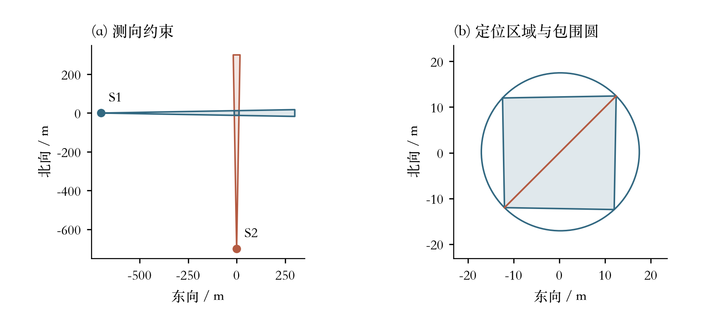
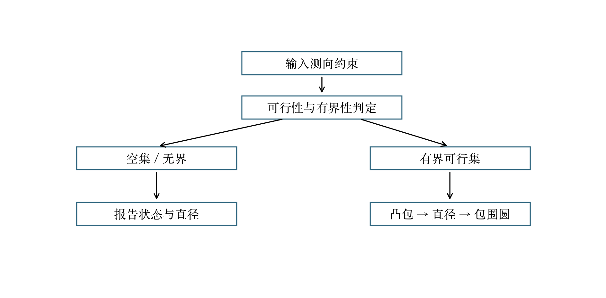
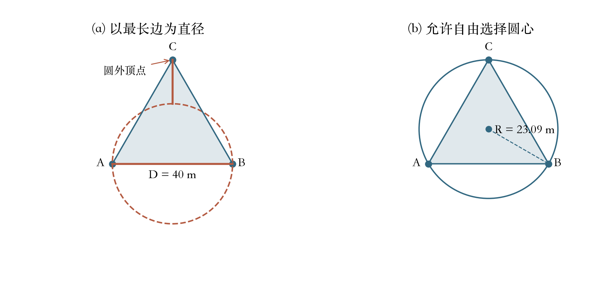
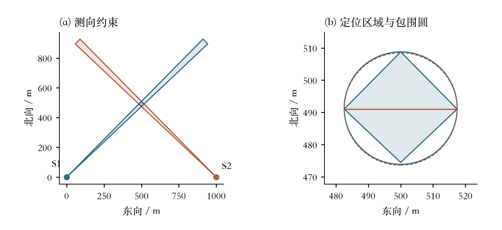
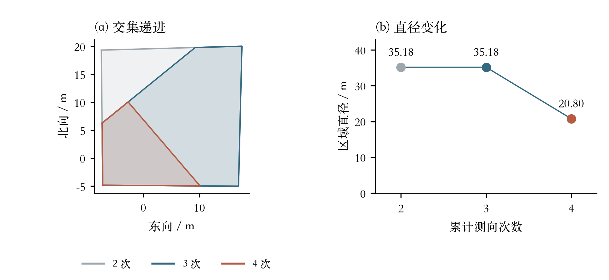
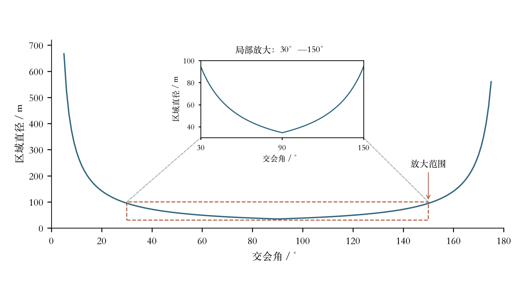

# 第1问图表与独立图注

**图1 交会定位。** 正交双点测向算例。检测点为(−700,0)、(0,−700)，误差半角为1°；右图放大左图原点附近的交集。区域直径D=34.57 m，最小包围圆半径R=17.28 m。红线为直径端点连线。

**图2 算法流程。** 第一问求解流程。先判断空集和无界情形，再对有界交集计算凸包、直径及最小包围圆；点与线段按退化凸集处理，不使用人为包围框代替无界判定。

**图3 三角形反例。** 可由三组合法测向约束构造的正三角形定位区域。为便于标注，图形作了平移；边长及区域直径均为40 m，最小包围圆半径为40/√3≈23.09 m，大于D/2=20 m。

**图4 两次测向反例。** 两次测向形成的四边形反例。蓝线为最小包围圆，红色虚线为以最长对角线为直径的圆；D=34.904813 m，R=17.455065 m，R−D/2=2.66 mm。两圆非常接近，覆盖失败以数值判据确认，不能仅靠视觉判断。

**图5 递进定位。** 按同一算例依次加入第二、第三、第四次测向约束。新增观测可以缩小可行集，但不保证每次都严格减小直径；第三次观测后的直径保持不变。

**图6 交会角敏感性。** 固定两检测点距目标均为700 m，真实读数误差为零，建模误差半角为1°。主图展示5°—175°范围的计算结果；砖红虚线框选出交会角30°—150°、区域直径30—100 m的局部，灰色虚线将该范围连接到上方放大图。放大图的横、纵坐标与主图含义及单位相同，仅改变显示尺度，并非另一组实验。局部图表明交会角接近90°时区域直径较小；该图为确定性几何实验。

