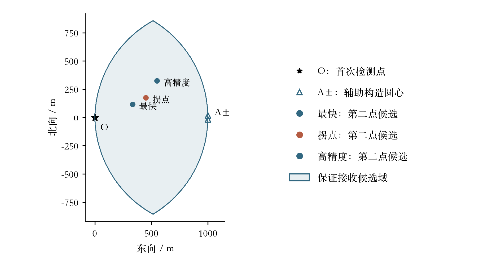
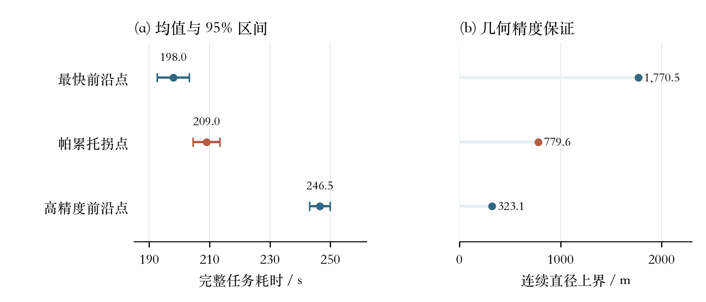

# 第2问图表与独立图注

**图1 保证接收候选域。** 标准局部坐标下的保证接收候选域，由以O、A+、A−为圆心、半径999 m的三个圆盘交集构成；其中1 m为数值安全余量。A±相距约34.9 m，在本比例下接近。星号O为首次检测点，空心三角形A±为构造保证接收域的辅助圆心，不是信号源；三个实心圆点为第二次检测的代表候选位置，砖红点为拐点方案，浅蓝填充表示保证接收候选域。区域边界以网格显示，候选可行性仍由解析条件判定。

**图2 时间与精度。** 三种代表方案在同一批512个独立样本上的复评结果。左侧误差棒表示任务耗时均值的95%置信区间；右侧为连续定位直径的几何上界，不是统计区间。砖红色为帕累托拐点。

